<!--
  =============================================================================
  Mohammed Abbas (@Mohabz35) - Animated GitHub Profile README
  Inspired by Avi Vashishta's animated SVG cards architecture.
  Auto-rendered & daily refreshed via .github/workflows/update-profile-art.yml.
  =============================================================================
-->

  <!-- 1. Hero Terminal Banner -->
  
    

  <!-- 2. Dual Terminal Windows: ASCII Portrait + Animated Live Stats -->
  <table border="0" cellpadding="0" cellspacing="0" width="100%">
    <tr>
      <td width="49.5%" align="center" valign="top">
        
      </td>
      <td width="1%"></td>
      <td width="49.5%" align="center" valign="top">
        
      </td>
    </tr>
  </table>
   

  <!-- 3. Live Contribution Heatmap (Animated Pop-in SVG) -->
  
    

  <!-- 4. Highlight / Focus Bento Cards -->
  <table border="0" cellpadding="0" cellspacing="0" width="100%">
    <tr>
      <td width="32.8%" align="center">
        
      </td>
      <td width="0.8%"></td>
      <td width="32.8%" align="center">
        
      </td>
      <td width="0.8%"></td>
      <td width="32.8%" align="center">
        
      </td>
    </tr>
  </table>
   

  <!-- 5. Featured Repositories -->
  <table border="0" cellpadding="0" cellspacing="0" width="100%">
    <tr>
      <td width="32.8%" align="center">
        
      </td>
      <td width="0.8%"></td>
      <td width="32.8%" align="center">
        
      </td>
      <td width="0.8%"></td>
      <td width="32.8%" align="center">
        
      </td>
    </tr>
  </table>

 

  <a href="https://m-abbaslab.vercel.app/"><b>Portfolio & Lab</b></a> &nbsp;•&nbsp;
  <a href="https://github.com/Mohabz35"><b>GitHub (@Mohabz35)</b></a> &nbsp;•&nbsp;
  <a href="https://linkedin.com/in/mohammedabbas"><b>LinkedIn</b></a>

